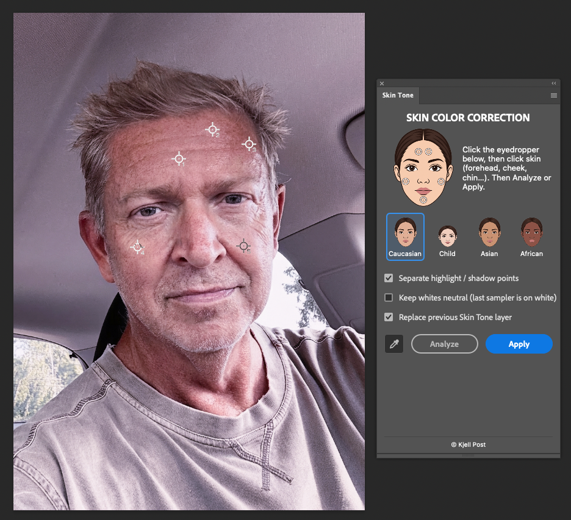
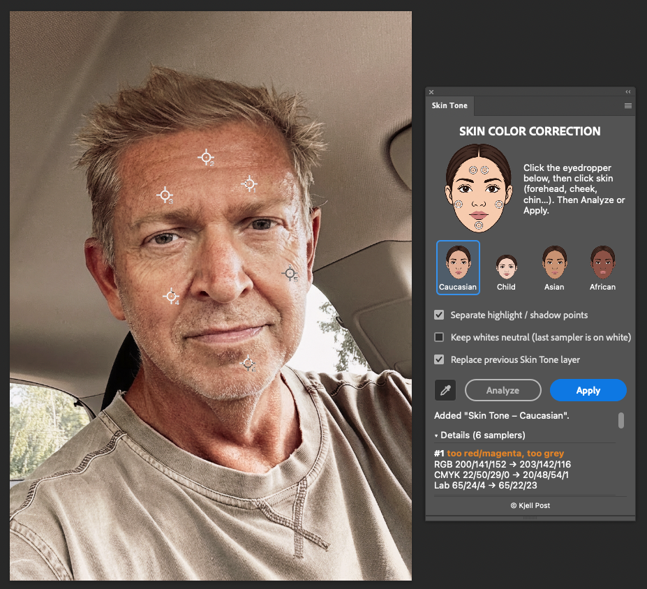

# Skin Tone Curves

A Photoshop UXP plugin that sets skin colour with an RGB Curves adjustment layer,
using presets derived from Lee Varis, *Skin* (2nd ed., ch. 3).

| Before | After (Caucasian preset) |
|---|---|
|  |  |

## Background: *Skin*, chapter 3

In chapter 3 of *Skin*, "The Color of Skin", Lee Varis argues that skin colour
should be judged by the numbers, not by eye. Our eyes adapt to colour casts, so a
photo that looks fine can still read too yellow, too red or too grey.

His method uses the Info panel with an 11×11 average sample and a CMYK readout.
Good skin has magenta and yellow almost equal, with yellow a few points higher but
not more than 10–15. Cyan should be about a quarter to a third of yellow; more than
that makes skin look grey. Highlights read lower overall, and shadows carry
relatively more cyan.

The ratios shift a little between groups:

- **Children:** lighter and pinker, though magenta should still not overtake yellow
  except on cheeks and lips.
- **Dark skin:** more cyan, with magenta raised up to equal yellow to avoid a green look.
- **Asian skin:** slightly more yellow, but not too yellow.

Varis corrects with a Curves adjustment layer, adjusting each RGB channel. Red
controls cyan, green controls magenta and blue controls yellow. First he finds the
real white and black points with a temporary Threshold layer and makes them neutral
(about 245 and 15). Then he moves the skin towards the target ratios, reading several
areas, not a single spot.

Finally he stresses that these numbers are guidelines. Taste varies between cultures
and clients: some want paler skin, some a "California tan". Good reproduced skin is
usually an idealised version, not literally accurate colour.

### What the plugin does

It reads your samplers as 11×11 averages and builds a per-channel RGB Curves layer
that moves the skin to the book's ratios for Caucasian, Child, Asian or African skin.
It keeps lightness, can optionally keep one white neutral, and leaves the strength to
the layer's opacity.

### What it doesn't do

- set the black and white points or find them for you;
- set contrast or tone;
- treat cheeks and lips specially, or mask the correction to the skin;
- handle the cultural or personal preferences Varis describes.

It sets a sensible starting colour, and you still judge the result yourself.

## How it works

Varis gives skin targets as CMY ratios in Photoshop's Info panel (SWOP v2), e.g.
Caucasian: Y a few points above M (≤ 10–15), C ≈ ¼–⅓ of Y.
`tools/gen_presets.py` separates a Lab grid through Adobe's SWOP profile with
LittleCMS and records, for each lightness, the Lab colour that satisfies each
preset's ratios (`plugin/core/preset-tables.js`). The plugin works in Lab, so it
does not depend on the user's CMYK settings.

| Preset | M/Y | C/Y | Calibrated on (book figure, CMYK) |
|---|---|---|---|
| Caucasian | 0.82 | 0.30 | 3.20: 17/40/50/1 · 3.23: 10/33/40/0 |
| Child | 0.84 | 0.22 | 3.23: 4/20/23/0 · 3.27: 7/21/27/0 |
| Asian | 0.77 | 0.33 | 3.25: 20/45/59/1 |
| African | 0.96 | 0.47 | 3.24: 34/70/70/24 |

The ratio rule is a midtone rule: below L≈60 SWOP moves density into K and fixed
CMY ratios would ask for over-saturated shadows. So hue always follows the
preset, chroma follows it only in the midtones (fading to the sample's own
chroma below), and chroma is capped at 1.15× the most saturated good book sample.

The solver (`plugin/core/solver.js`) groups samples by lightness, maps each
group's mean RGB to the preset target at the same L (lightness is preserved),
and emits one curve point per group per channel.

## Use

1. Download [skin.tone.curves_PS.ccx](https://github.com/kjepo/skin/raw/main/package/skin.tone.curves_PS.ccx) and
   double-click it; Creative Cloud installs it into Photoshop (2023 or later). The
   panel is under **Plugins → Skin Tone Curves → Skin color**.
2. Open an RGB image (sRGB, Adobe RGB, Display P3 or ProPhoto RGB).
3. Click the eyedropper in the panel: it selects the Color Sampler tool and sets its
   Sample Size to 11×11 Average. Click skin to drop samplers; the plugin always reads
   each one as an 11×11 average, whatever the tool setting. Midtones (forehead, cheek, chin) matter most; add a
   highlight and a shadow sampler for separate tonal points.
4. In the **Skin color** panel click a preset face, then **Analyze** (preview with
   Info-panel style CMYK) or **Apply** (adds a `Skin Tone – <preset>` Curves layer).
   To soften the correction, lower the layer's opacity.
5. Optional: tick **Keep whites neutral** and drop one more sampler, *last*, on
   something that should be white (shirt, dress, wall). It is mapped to neutral at
   its own lightness, as the book does before correcting skin. Whites take
   priority: if skin and white can't both be met with a smooth curve, the skin
   correction is scaled back and the panel says by how much. (Lowering layer
   opacity afterwards also relaxes the white.) A white that isn't
   brighter than the skin in every channel can't share the curve and is ignored.

## Development

Load `plugin/` in **UXP Developer Tool** (Add Plugin → `plugin/manifest.json` → Load);
after editing, use Reload. Package with UXP Developer Tool → Package into `package/`.

```sh
npm test            # core tests (Node ≥ 20), no Photoshop needed
npm run gen         # regenerate preset tables + fixtures (needs transicc and Photoshop's SWOP profile)
```
